# The cockpit block-outs

Ten seated, sealed cockpits blocked out in Blender the CSG way (`tools/blender/build_cockpit_blockouts.py`) to
choose from before any is modelled in detail. They are on the Mech Cockpits page
(https://claude.ai/artifact/AqMpKdiBjn9e1uQPT1c1aj), where each one can be scrubbed through its opening, front door
or back, from the pilot's eye or outside. The owner, 2026-10-24: "Panorama and lowbank I think are my top two, I'd
take screenshots and document the rest for use later", and "with these changes, all these cockpits are viable
candidates".

Each entry has three pictures:
- the front door opening, from outside, at 0, 30, 60 and 100 percent of the way;
- the back door opening, seen from behind, at the same points;
- the pilot's view, sitting in the closed cockpit.

Every opening runs in stages. Clamps slide clear, the seal breaks with steam, then the parts move. Every part moves
away from the body and the cabin, so nothing passes through anything. Where the pilot climbs out through the
front, the dash rides the part that opens. With the back door, the seat swivels round to face it. How each one
opens is in `cockpit.md`.

## Panorama

One wide front screen, 1.9 m across, the pillars pushed out to the corners; square side screens to the shoulders. Armored Core's front.

**Top two.** The owner's pick for detailing, with Low bank.

- Clear ahead: 93 degrees (back door: 96 degrees). Screens span 231 degrees.
- Front door, 2.9 s: the front splits at the screens' foot: clamps slide off the seams, both halves pop off their seals, the bottom drops to the deck as a step, then the top swings up about the roof edge carrying the dash.
- Back door, 4.1 s: by the back: a hatchback, the back wall and the back of the roof swinging up on two rams, then the seat swivels round to face it; the screens ahead never move.
- MFDs: on the viewscreen, along the top of the front screen, as a HUD, on the dash.
- 544 triangles (front-door version).

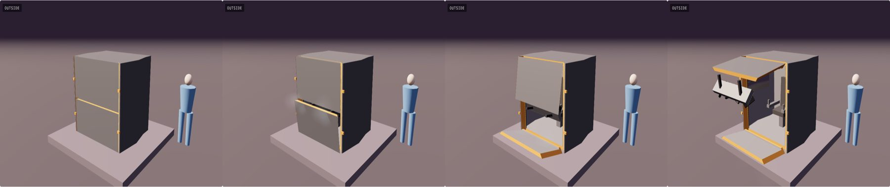

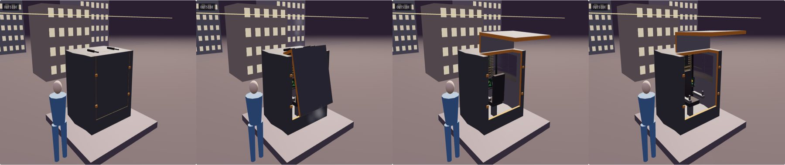

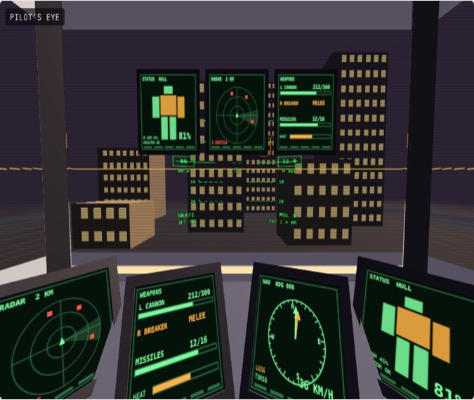

## Tile wall

Two rows of square tiles round 210 degrees, a centimetre of wall between them and no pillar ahead: the structure is behind the pilot's shoulders.

- Clear ahead: 210 degrees (back door: 210 degrees). Screens span 210 degrees.
- Front door, 3.2 s: three petals: the two side ones swing out on their outer edges like doors, then the middle one pops and swings up carrying the dash; the seams fall on the screens' own seams.
- Back door, 4.1 s: by the back: the back wall unclamps and drops back to the deck as a ramp, then the seat swivels round to face it; the screens ahead never move.
- MFDs: on the dash.
- 934 triangles (front-door version).

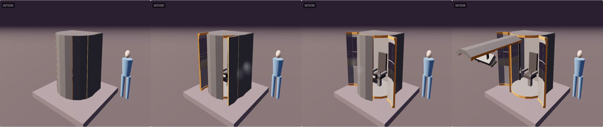

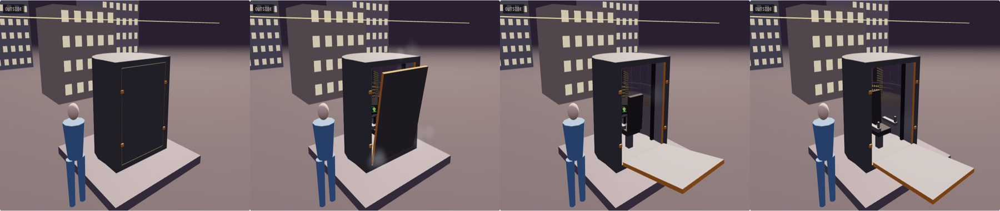

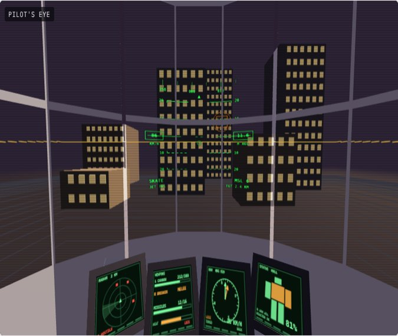

## All-view sphere

The Gundam pod: a ball of flat screens all round, under the feet and overhead too; the seat on its arm in the middle, the MFDs on the armrests.

- Clear ahead: all round (back door: all round). Screens span 360 degrees.
- Front door, 4.0 s: a curved visor plate, outside the ball, turns up over the top about the pilot's eye; then the seat runs forward on its rail to the opening.
- Back door, 4.1 s: by the back: a visor plate behind the ball turns up over the top about the pilot's eye, then the seat swivels round to face the opening.
- MFDs: on the armrests, riding with the seat.
- 936 triangles (front-door version).

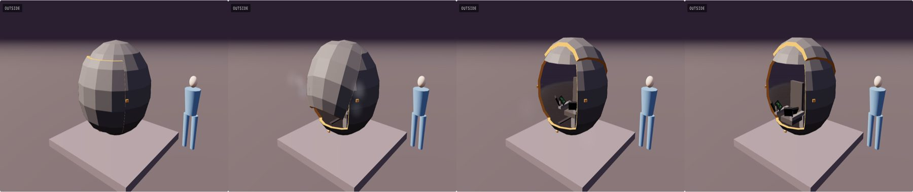

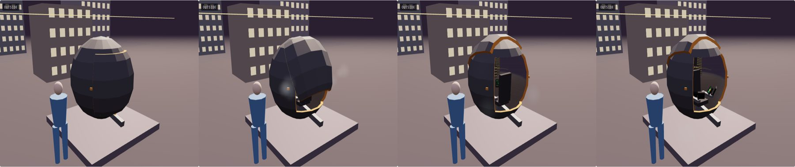

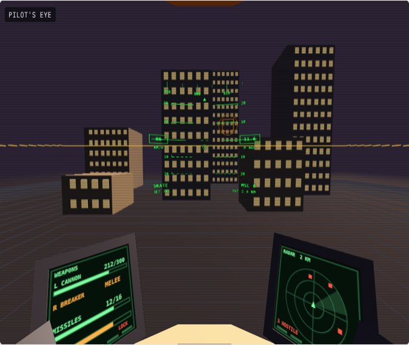

## Titan

Titanfall's: a front screen 1.6 m across, side screens raked back, a heavy frame but all of it outside 45 degrees.

The strip of wall left across the doorway ("this bar") is gone.

- Clear ahead: 91 degrees (back door: 94 degrees). Screens span 228 degrees.
- Front door, 3.2 s: the top half rises clear of the roof line, then tilts back; the bottom half drops as a step.
- Back door, 4.1 s: by the back: the back wall unclamps and drops back to the deck as a ramp, then the seat swivels round to face it; the screens ahead never move.
- MFDs: on the viewscreen, along the top of the front screen, as a HUD, on the dash.
- 572 triangles (front-door version).

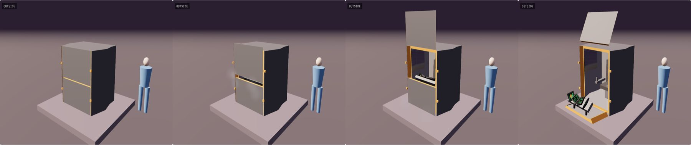

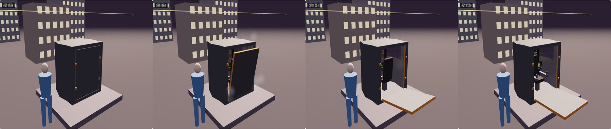

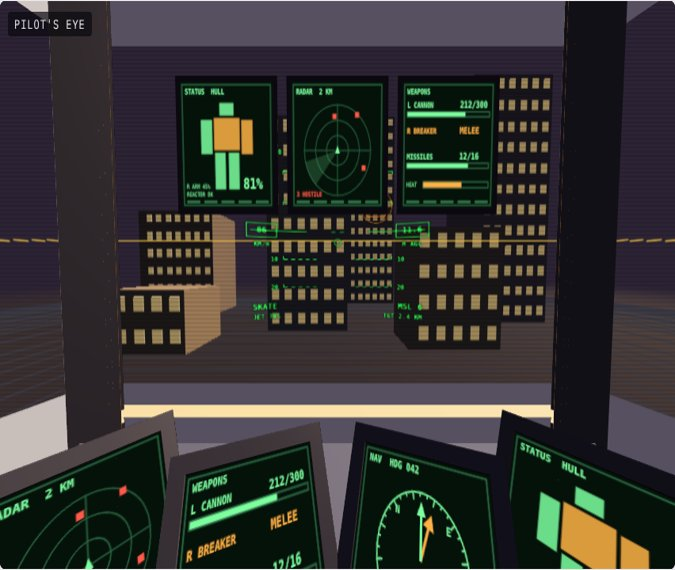

## Cinema

One huge front screen 2.2 m by 1.05 m with no seam at all, square screens beside the knees.

A hinged door, not a slider: "I dont know where that long slider would go on a mech practically".

- Clear ahead: 95 degrees (back door: 98 degrees). Screens span 175 degrees.
- Front door, 3.0 s: a heavy door: clamps slide off the free edge, it pops off its seal, then swings out on three hinges at its right edge with the dash on it.
- Back door, 4.1 s: by the back: a hatchback, the back wall and the back of the roof swinging up on two rams, then the seat swivels round to face it; the screens ahead never move.
- MFDs: on the dash.
- 544 triangles (front-door version).

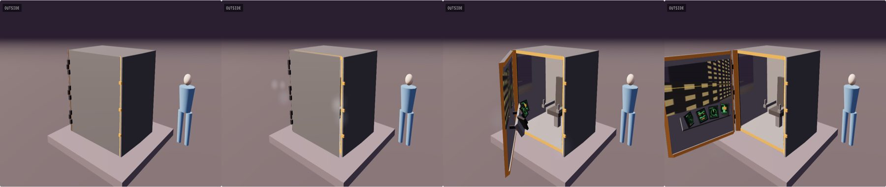

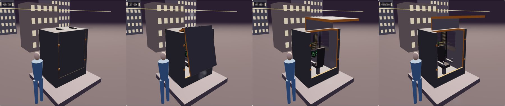

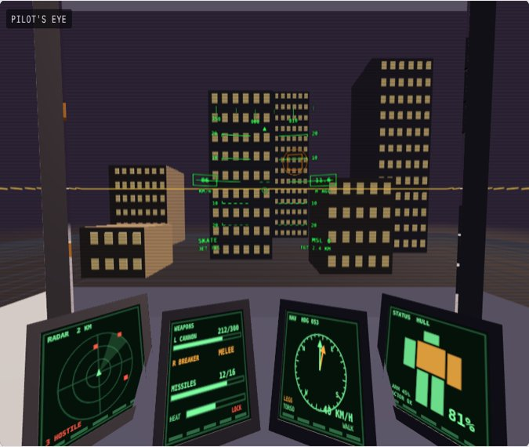

## Excavator cab

Floor to roof screens like a digger's glass cab, and a screen under the feet looking down at the ground ahead.

"excavator cab, excellent, classic". Its MFDs are on the viewscreen, not overhead: "too hard to see during gameplay".

- Clear ahead: 87 degrees (back door: 90 degrees). Screens span 233 degrees.
- Front door, 2.8 s: the whole front, floor to roof, unclamps and drops forward on its bottom edge to the deck as a ramp.
- Back door, 4.1 s: by the back: the back wall unclamps and drops back to the deck as a ramp, then the seat swivels round to face it; the screens ahead never move.
- MFDs: on the viewscreen, along the top of the front screen, as a HUD.
- 480 triangles (front-door version).

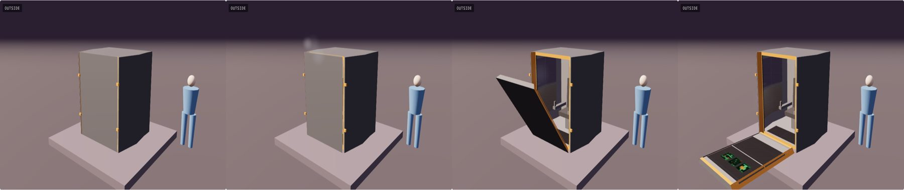

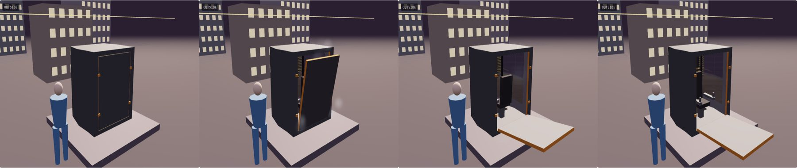

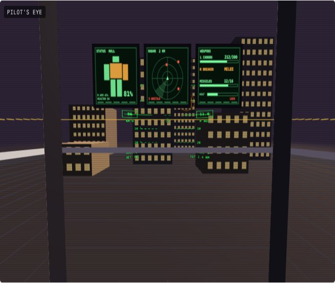

## Octagon

The Stevedore's octagon, seated now and stretched so its front is 1.6 m across: pillars at 45 degrees instead of 21.

Its front drops as a step as well as the gull wings: "octagon front I think still needs to open".

- Clear ahead: 87 degrees (back door: 90 degrees). Screens span 261 degrees.
- Front door, 2.9 s: gull-wing doors: each side, roof edge and all, turns up about a hinge on the roof, and the front drops forward as a step with the dash on it.
- Back door, 4.1 s: by the back: a hatchback, the back wall and the back of the roof swinging up on two rams, then the seat swivels round to face it; the screens ahead never move.
- MFDs: on the viewscreen, along the top of the front screen, as a HUD, on the dash.
- 884 triangles (front-door version).

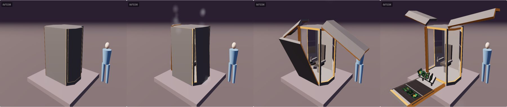

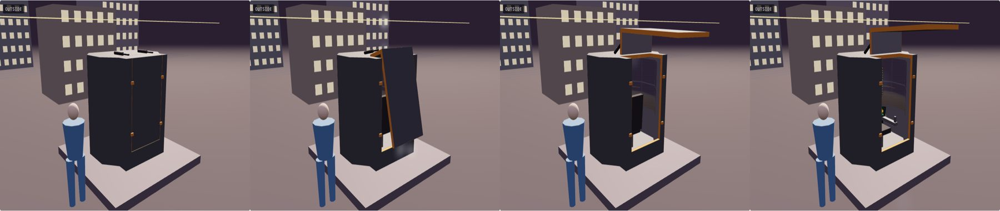

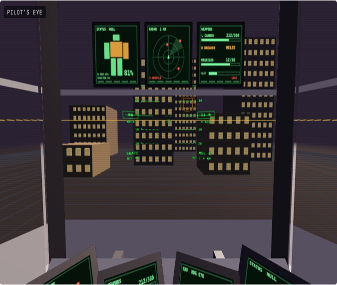

## Canopy

A fighter's canopy in flat screens: the front half of the ceiling is screens too, so you see up as well as out.

"canopy is also a cool one". It now just tilts up at the back: the owner thought the slide back "looks like its gonna hit me in the face".

- Clear ahead: 93 degrees (back door: 93 degrees). Screens span 228 degrees.
- Front door, 2.8 s: a fighter's canopy: everything above the sill, screens, roof and bubble, lifts off its seal and tilts up on its back edge on two rams.
- Back door, 4.1 s: by the back: two doors swing out on hinges at the back corners, then the seat swivels round to face them; the screens ahead never move.
- MFDs: on the dash.
- 652 triangles (front-door version).

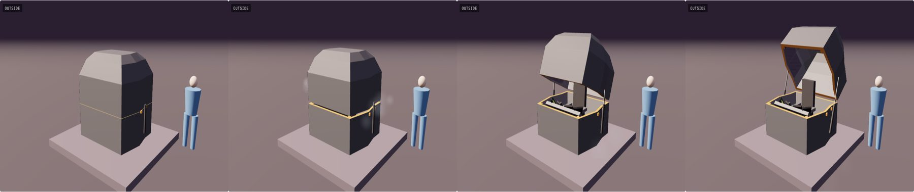

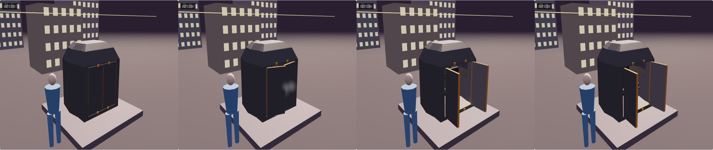

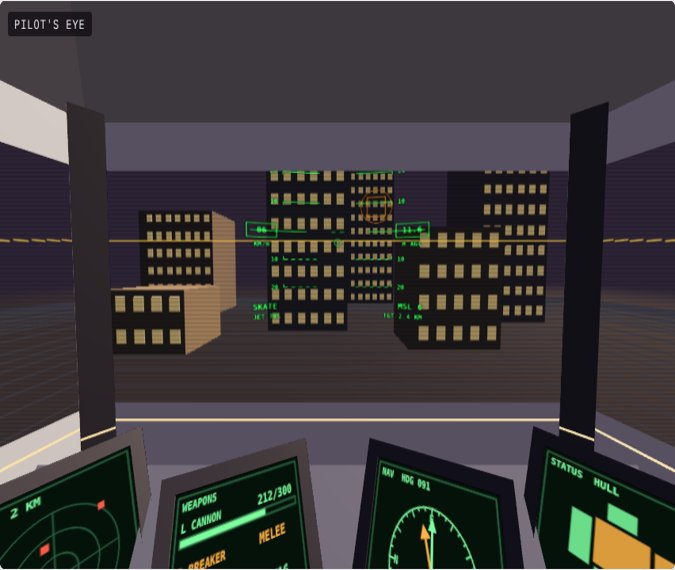

## Twin tier

Two rings of square screens round 190 degrees with one thin rail between them under the eye line.

"this one is cool". The dash is sized to the round cabin and rides the dropping step.

- Clear ahead: 190 degrees (back door: 190 degrees). Screens span 190 degrees.
- Front door, 3.5 s: the upper ring of screens and the bubble rise straight up on four rams and tilt back, then the front of the lower ring drops as a step.
- Back door, 4.1 s: by the back: two doors swing out on hinges at the back corners, then the seat swivels round to face them; the screens ahead never move.
- MFDs: on the dash.
- 1,050 triangles (front-door version).

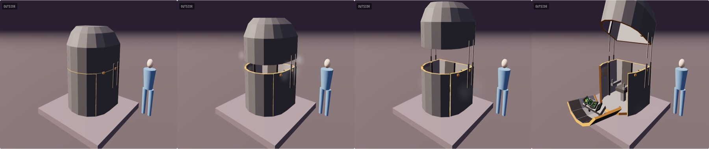

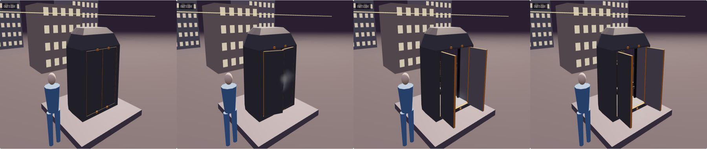

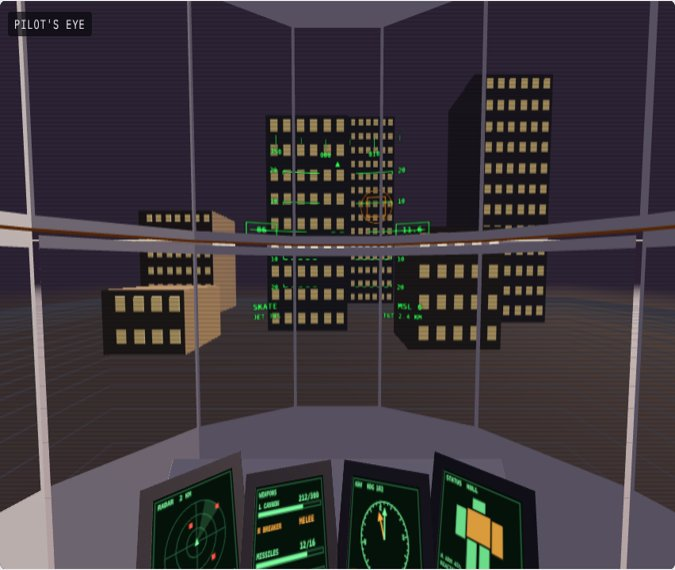

## Low bank

The Ironhorse's low screen bank, seated and widened: a front 1.5 m across, the wings swept back past the knees.

**Top two.** "low bank is classic, love it".

- Clear ahead: 74 degrees (back door: 74 degrees). Screens span 226 degrees.
- Front door, 2.8 s: a fighter's canopy hinged at the front: the whole bubble above the sill lifts and swings up and forward over the nose on two rams.
- Back door, 4.1 s: by the back: the back wall unclamps and drops back to the deck as a ramp, then the seat swivels round to face it; the screens ahead never move.
- MFDs: on the dash.
- 608 triangles (front-door version).

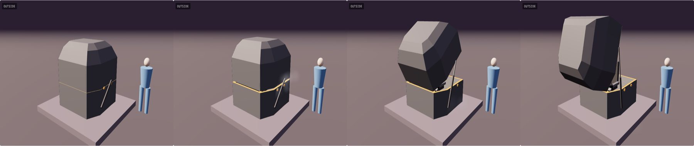

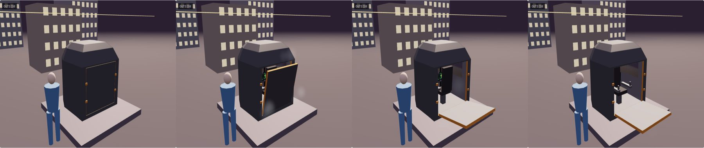

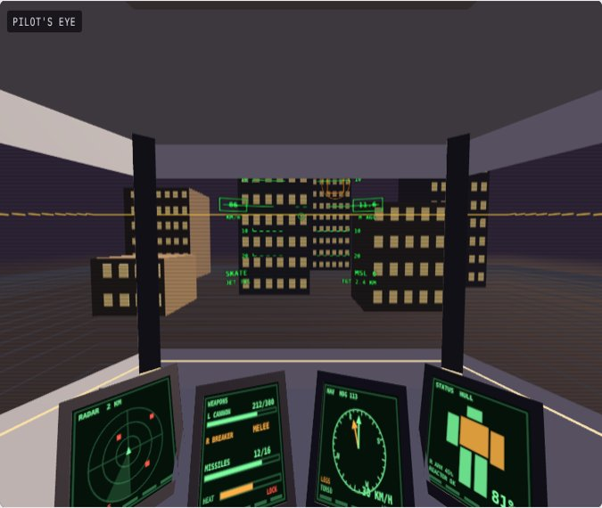
