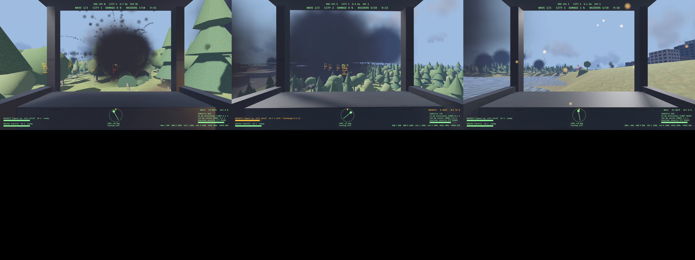
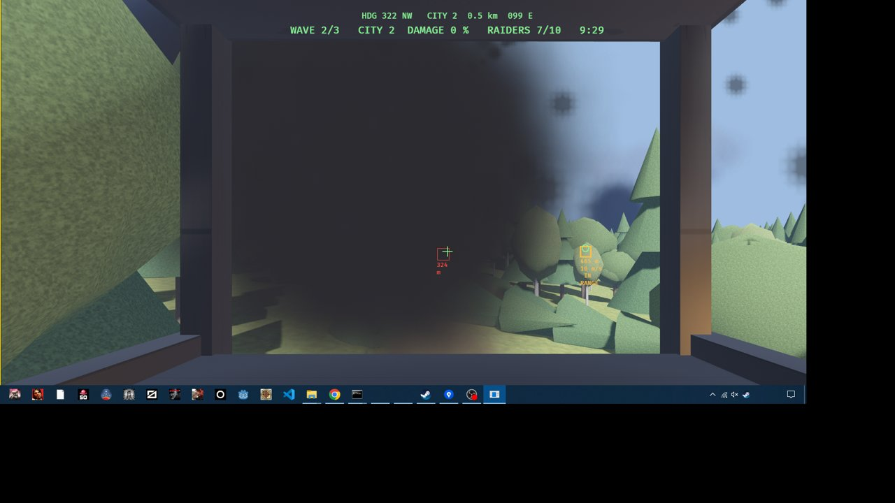

# Playtest: city defence, 2026-10-24

- **Build:** branch `city-defence-fx` on top of `7318660`, with uncommitted targeting and lock-on missiles (committed after this report as the next commit), release.
- **Machine:** the owner's Windows desktop (DESKTOP-2GCKC3F): RTX 3070, i7-9700F, 32 GB.
- **Take:** `crab-breeze --showcase defence`, recorded with OBS (Game Capture of the window, 1920 x 1080, 60 fps) from `PLAYTEST_START` to `PLAYTEST_END`, uncut, first person throughout, the walk and the climb into the cockpit included.
- **Drive:** [crab-breeze-2026-10-24-city-defence.mp4](https://drive.google.com/file/d/16NuGdZfgSl4hRF4F5AG6uoFIeNPneE0E/view) (H.264, CRF 26, 4 min 8 s, 95 MB), confirmed with the Drive connector.
- **Result:** `PLAYTEST_RESULT win defence: all 30 raiders destroyed`; cities 1, 2 and 3 ended at 0.1 %, 0.3 % and 0.7 % damage.

## Beats

| Beat | Outcome |
| --- | --- |
| load, look, board | walked to the mech, it knelt and opened, climbed in, seated |
| travel1, fight1 | wave 1 (city 1) cleared in about 50 s |
| travel2, fight2 | rockets over the woods to city 2; targeting boxes, `IN RANGE` and missiles on locks; wave 2 cleared, city 2 at 0.3 % |
| travel3, fight3 | wave 3 (city 3) cleared, city 3 at 0.7 %; `ALL WAVES DESTROYED: THE CITIES STAND` |

## Runs before the take (unrecorded, logs in `output/takes/`)

1. **Run 1-2:** stalled on wave 1 at 2 raiders. One raider spawned inside city 2's buildings and never moved; the pilot crawled after far raiders with the orbiting brain. Fixed: spawn points turn along the ring until clear of other cities (test `spawn_points_are_dry_inside_the_world_and_outside_other_cities`); a far target is travelled to.
2. **Run 3:** won wave 1, then stuck in an alley in city 2 steering straight at raiders. Fixed: travel follows open streets (a 40 m chest-height probe).
3. **Run 5:** with rockets and skates for travel (the owner: "You have rocket pack and skates"), won all three waves in about 4.5 minutes.

## What this shows, and what it does not

- The mission plays start to finish and can be won. It is **too easy**: no city came near the 50 % limit (the worst was 0.7 %), and no wave came near its 10 minutes (the slowest took under 2). The siege estimate in the design (an undefended city falling in about 6 minutes) is wrong by a long way: a 25 mm round breaks about one cell, towers rarely collapse, and the raiders spend their time on the pilot. Retuning the siege (task 3.2) and the raiders' toughness is next; the design's numbers stay marked as an estimate.
- Frame time was not measured; `--bench defence` is task 3.3.
- Rocket trails, fireballs, smoke columns and muzzle flashes are visible in the take; flipbook sprites are still the survey's G7.
