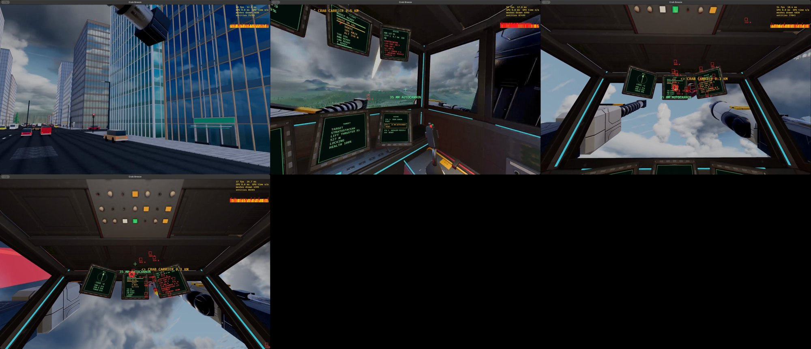

# Playtest: fortress-down, 2026-10-30

The scripted pilot brings the Stratostacean down (`data/playtests/fortress-down.ron`, the `BringDownFortress` beat,
openspec/changes/crab-airship section 10).

- **Commit:** `main` at `b930ca08` with the uncommitted changes of this work (the fortress over the city's centre, lit
  hull thrusters lockable, the beat).
- **Machine:** the owner's MacBook Pro, windowed at 1920 x 1080. The owner said to run it.
- **Mech:** the Foreman (35 mm autocannon for the lift thrusters, shoulder missiles for the hull thruster).

## Runs

| Run | Recorded | Outcome |
|---|---|---|
| 1 | no | four port lift thrusters down by the autocannon from about 1.3 km; stood 2 km off the hull thruster, out of missile reach. Stopped |
| 2 | no | the same; then hovered at the edge of its band, 950 m out, never closing. Stopped |
| 3 | no | closed to 500 m and fired missiles; they came in about 45 deg off vertical and did nothing to the 300 mm hull. Ended stuck (its goal moves with the fortress) |
| 4 | no | stood about 120 m off, nearly under it: missiles took HL1 from 900 to 270 hp, then the mech stood wedged on something at full throttle. Stopped |
| 5 | no | with the runner's detour round obstacles: **won**, the Stratostacean down 173 s into the fight, 58 buildings under it |
| 6 | yes | **won**, down in 162 s: L1, L2, L3, L4, then HL1; 64 buildings under it, city 1 at 13.7 % damage |

## The recorded take

- Drive: `G:/My Drive/dungeon-crawler-2026/crab-breeze-2026-10-30-fortress-down.mp4` (H.264, crf 26, 58 MB, 3 min 21 s).
  Copied by Drive for Desktop; not confirmed with the Drive connector (not connected in this session).
- Contact sheet: 
- First person throughout: the walk, boarding, the cockpit with the fortress boxed on the screens.

## What it showed

- The fortress appears over the nearest city's centre and flies out to its circle.
- The Foreman cannot aim above 25 deg, so it fights the lift thrusters from 1.2-1.5 km and the hull thruster from
  nearly under it with missiles; nothing else gets through the hull port.
- The frame rate under the fortress dips to 37-60 fps on the Mac (the HUD in the contact sheet); not a measurement.
